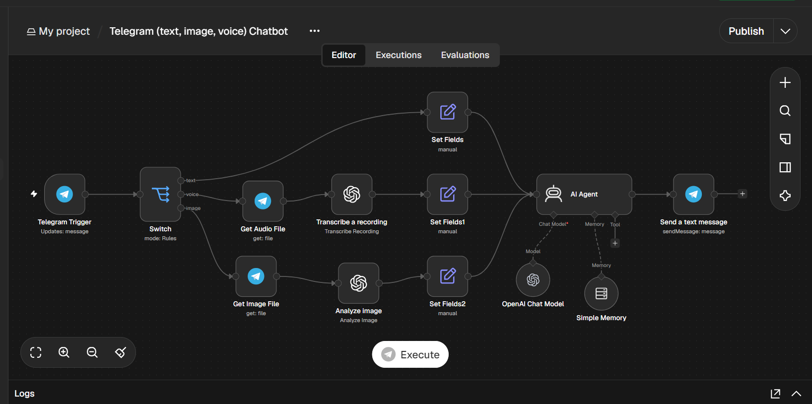
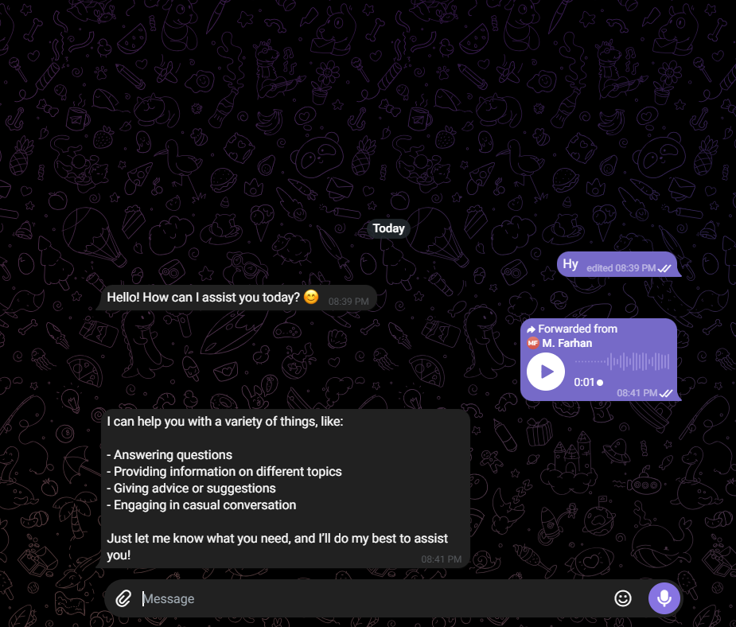

# Multimodal Telegram AI Chatbot — n8n Workflow

A smart Telegram chatbot built with n8n that understands **text, voice messages, and images**. Voice notes are transcribed, photos are analyzed, and an AI agent with conversation memory replies in the same language the user writes in.

**English, Urdu, and Roman Urdu supported.**

---

## What It Does

```
User sends a message on Telegram
            ↓
      ┌─────┼──────┐
      ↓     ↓      ↓
    Text  Voice  Image
      │     ↓      ↓
      │  Whisper  Vision model
      │  transcribe  analyzes photo
      └─────┼──────┘
            ↓
   AI Agent (GPT-5-mini + memory)
            ↓
     Reply sent on Telegram
```

**One bot. Three input types. Zero extra apps.**

---

## Features

| Feature | Description |
| --- | --- |
| Text chat | Normal conversational replies |
| Voice messages | Transcribed with OpenAI Whisper, then answered like regular text |
| Image understanding | Photos are analyzed by a vision model and the AI responds based on what it sees |
| Conversation memory | Remembers the last 20 messages per user |
| Language matching | Replies in the same language as the user (Urdu, English, Roman Urdu, etc.) |
| Concise, warm tone | Short, clear, human-like answers set via the system prompt |

---

## Tech Stack

| Tool | Purpose |
| --- | --- |
| n8n | Workflow automation |
| Telegram Bot API | Chat interface |
| OpenAI GPT-5-mini | AI agent / reasoning |
| OpenAI Whisper | Voice-to-text transcription |
| OpenAI Vision | Image analysis |

---

## Workflow Overview

```
[Telegram Trigger] → [Switch] ─ text  → [Set Fields] ─────────────────────────────────────┐
                              ├ voice → [Get Audio File] → [Transcribe] → [Set Fields1] ───┤
                              └ image → [Get Image File] → [Analyze image] → [Set Fields2] ┤
                                                                                           ↓
                                                    [AI Agent] ← Chat Model + Simple Memory
                                                         ↓
                                               [Send a text message]
```

**14 nodes. Fully automated. Runs 24/7.**

---

## Setup

### 1. Create a Telegram Bot

Message [@BotFather](https://t.me/BotFather) on Telegram → `/newbot` → copy the **bot token**.

### 2. Import Workflow

Open n8n → **Import from file** → select `workflow.json`

### 3. Add Credentials

| Credential | Where to get |
| --- | --- |
| Telegram API (bot token) | @BotFather |
| OpenAI API Key | platform.openai.com |

Credentials are stripped from the exported file, so after import open each Telegram and OpenAI node and select your own.

### 4. Configure Nodes

- **Analyze image** — choose a vision-capable OpenAI model available on your account
- **OpenAI Chat Model** — change the model if you prefer (e.g. a cheaper or faster one)
- **AI Agent** — edit the system message to change the bot's personality or rules

### 5. Activate

Toggle the workflow **Active**, open your bot in Telegram, and send a text, a voice note, or a photo.

---

## Screenshots

**Workflow**



**Telegram conversation (text + voice)**



---

## Known Limitations

- Image captions are ignored. Only the photo itself is analyzed.
- The image branch reads the 4th photo size from Telegram's `photo` array, so very small images with fewer sizes may fail.
- Memory is in-process (Simple Memory) and resets when n8n restarts. Use Postgres/Redis memory for persistence.
- The bot replies with text only.

---

## Use Cases

- **Personal AI assistant** — chat by text, voice, or photo from one place
- **Customer support prototype** — handle mixed-format messages
- **Accessibility** — voice-first interaction for users who prefer speaking
- **Starter template** — extend with tools, documents, or a knowledge base

---

## License

MIT — free to use and modify.
